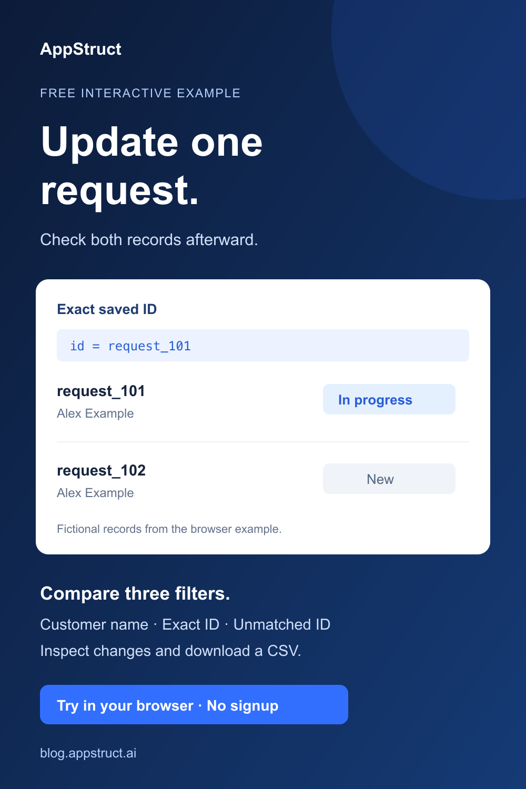

# No-code database practice kit

A small, dependency-free exercise for a bug that can survive a successful update: selecting the wrong record.

Two fictional requests belong to the same person. Compare a customer-name filter, an exact saved-ID filter and an unmatched ID before repeating the check in your own connected app.

<p></p>

## Run the example

Download this repository, open its directory and run:

```sh
node two-record-selection-check.mjs
```

No package installation, account, API key or database is needed. The script uses Node.js built-ins; checked with Node.js 22.16.0.

Expected output:

```text
Passed: wrong selector, exact-ID selector, no match, unchanged fixture.
```

| Selector | request_101 | request_102 |
| --- | --- | --- |
| Customer name: Alex Example | In progress | In progress |
| Exact ID: request_101 | In progress | New |
| Unmatched ID | New | New |

The assertions also confirm that the original fixture stays unchanged. `request_101` and `request_102` are teaching identifiers; use the actual saved IDs when testing your own backend.

## Repeat the check against a real connection

1. Use an authorized practice project and fictional records.
2. Save two requests with the same customer name and record their actual IDs.
3. Read the selected request back by its saved ID.
4. Update that request, then read both records again.
5. Repeat from the intended allowed and denied sessions.
6. Reopen the published app and record the observed result.

Use [the 16-case Supabase worksheet](supabase-connection-validation.csv) to record connection scope, schema discovery, sessions, inserts, selection, updates, denied operations and published-app checks. Every result begins as **Not checked**. Keep keys, passwords and personal customer data out of the worksheet.

Choose a reading brief for [AppStruct tables](briefs/appstruct-tables.txt), [an existing Supabase project](briefs/supabase.txt) or [an HTTP API](briefs/http-api.txt). Each starts as **Not tested** and identifies who configures the connection.

## Try the browser version and continue the walkthrough

[Open the interactive example and database guide](https://blog.appstruct.ai/blog/no-code-database-integration-guide-2025?utm_source=github&utm_medium=referral&utm_campaign=supabase_connection_20261113&utm_content=database_practice_repo_01#database-selection-demo).

The same guide covers AppStruct table actions, Supabase connection steps and external HTTP API mappings. You can read it and try the local browser example without signing up. Creating your own connected app requires an AppStruct account, applicable access and a configured backend.

This kit models selection logic in memory. It does not connect to Supabase, create an AppStruct project, verify access policies or establish that a real application is ready for customer data. A passing local assertion is one teaching result; record real integration results separately.

## Source and license

Published by [AppStruct](https://appstruct.ai/app-builder?utm_source=github&utm_medium=referral&utm_campaign=supabase_connection_20261113&utm_content=database_practice_repo_01__readme_builder). The runnable fixture and worksheet also appear in our public database guide. The diagram is an original teaching illustration, not a product screenshot.

MIT license. See [LICENSE](LICENSE). The release archive is a convenience copy of the same public files; it contains no credentials or account-specific records.
